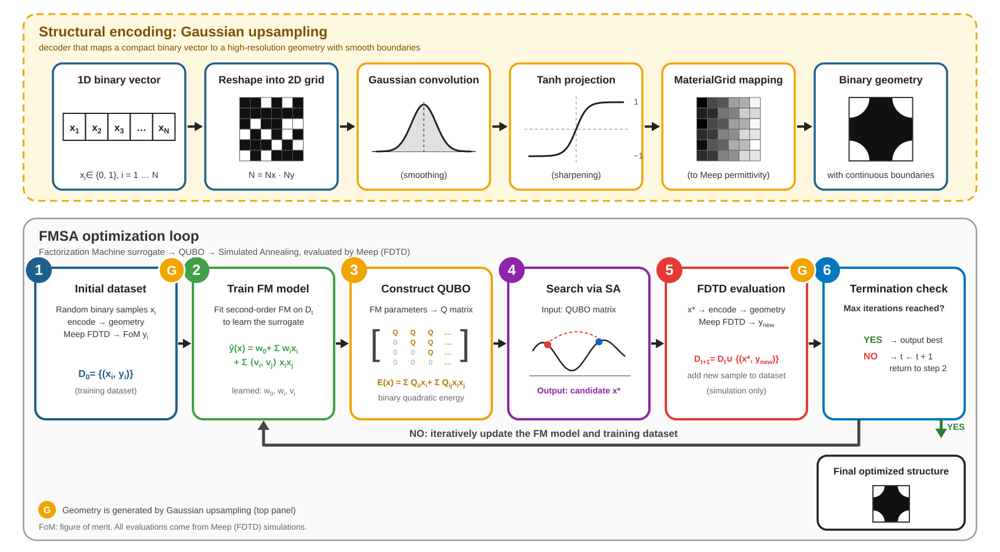
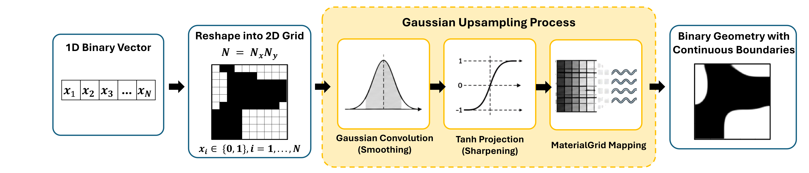
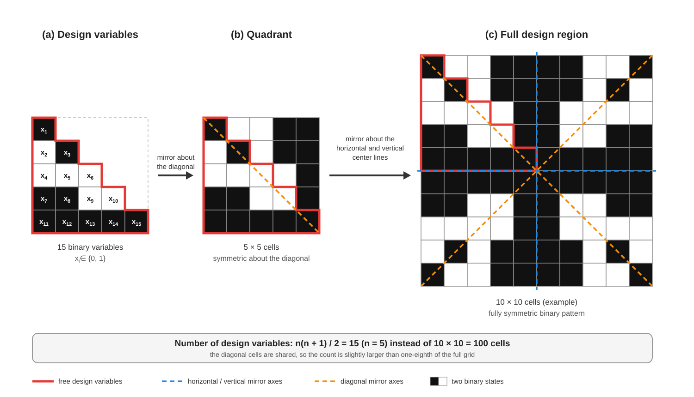

 <h1>Ultra-compact dual-mode Waveguide Crossing   via FMSA & Gaussian Upsampling</h1> 
 <strong>利用因子分解機結合模擬退火/量子退火 (Factorization Machine Quantum/Simulated Annealing)演算法  進行交叉型波導結構之反向設計。</strong> 
 
 <a href="#概述">概述</a> · <a href="#方法">方法</a> · <a href="#結果">結果</a> · <a href="#教學">教學</a> · <a href="#重現方式">重現方式</a> · <a href="#引用">引用</a> 
 
    
 

 <em> 圖 1. 結構編碼、FMSA/QA 最佳化與電磁模擬評估流程總覽。 </em> 
 

## 概述
<!-- 【放什麼】三段，各 2–3 句： 1. 問題：矽光子逆向設計的設計空間很大 2. 做法：用結構編碼把高解析度結構壓成少量變數，再用 FM 代理模型 + QUBO + SA 搜尋 3. 動機：QUBO 形式可部署到量子退火器 -->

由於光學元件通常具有高維度設計空間，直接以二值像素進行最佳化將增加代理模型建構與搜尋的困難，
因此本研究進一步導入不同的編碼方式作為結構表示方法，來降低設計空間複雜度，同時提升結構表示能力與最佳化效率。

本研究具體採用了高斯上採樣(Gaussian Upsampling)編碼策略。

光學模擬的部分，本研究利用基於有限差分時域法(Finite-Difference Time-Domain, FDTD)的開源套件MEEP，
針對橫電(TE)模態在矽光元件中的傳輸行為進行模擬與分析。

本研究設計並分析了交叉波導(Waveguide Crossing)。
其中，交叉波導則利用結構對稱性降低設計變數維度，在減少設計空間的情況下還能有效抑制模態轉換與串擾(Crosstalk)，並維持高傳輸效率。

編碼後的變數經電磁模擬評估，並以二階因數分解機（Factorization Machine, FM）作為代理模型，
建構二次無約束二元最佳化（QUBO）問題，再交由模擬退火（Simulated Annealing, SA）求解。
由於代理模型以 QUBO 表示，同一套公式也可部署於量子退火器。

可作為未來矽光子反向設計與光子積體電路(Photonic Integrated Circuits, PICs)設計之參考。

注意： 本專案所有結果皆來自 FDTD 模擬（Meep），未進行元件製作或實測。

## 主要貢獻
<!-- 【放什麼】三點即可，每點一句「做了什麼」，不要寫成「用了什麼」。 下面是依你論文內容寫的版本，請對照自己的論文修改。 -->
- FMSA 反向設計架構： 建立可應用於二維矽光子元件的 FMSA 反向設計架構，並以交叉波導為例，完整示範結構編碼、FM 代理模型、QUBO 與 SA 的最佳化流程。
- Gaussian upsampling 結構編碼： 以 Gaussian 卷積、tanh 投影與 MaterialGrid 映射，將少量二元變數轉換為具連續邊界的高解析度結構，作為 FMSA 的結構編碼方式。
- 可重現的 Tutorial： 提供交叉波導的 Jupyter Notebook 教學與 Meep 模擬程式，方便讀者重現與延伸。
    
## 方法
1. 結構編碼
- Gaussian upsampling： 將 1D 二元向量重組成 2D 網格，經 Gaussian 卷積（平滑）、tanh 投影（銳化）與 MaterialGrid 映射，轉換為具連續邊界的二元幾何。
- 八分之一對稱結構： 利用交叉波導的對稱性，只設計八分之一的區域，再以對稱展開得到完整設計區域，大幅減少設計變數。
  
(a) Gaussian upsampling 流程
<!-- 【放什麼】GU_Framework.png 改名為 gu_framework.png，放進 assets/。 可補參數：網格大小 Nx × Ny、Gaussian 的標準差 σ、tanh 的銳化係數 β。 --> 
 
 
 <em>圖 2. Gaussian upsampling：從 1D 二元向量到具連續邊界的二元幾何。</em> 

二元向量中的每個變數對應 2D 網格中的一格；Gaussian 卷積使相鄰格子的邊界變得平滑，tanh 投影再把灰階值推回接近 0 或 1，最後經 MaterialGrid 映射成 Meep 可用的材料分佈。如此可用少量二元變數表示高解析度結構，並避免鋸齒狀邊界。

(b) 八分之一對稱結構編碼
<!-- 【放什麼】八分之一結構的圖，檔名 assets/crossing_symmetry.png。 建議圖中標出：被設計的八分之一區域、對稱軸（x、y 軸與對角線）、展開後的完整 2.4 μm × 2.4 μm 結構。 --> 
 
 
 <em>圖 3. 八分之一對稱結構編碼：只設計八分之一區域，再對稱展開為完整交叉波導。</em> 

交叉波導的幾何對 x 軸、y 軸與對角線具有鏡像對稱，因此完整的設計區域可由其中八分之一經鏡射展開得到。最佳化時只需決定這八分之一區域的二元變數，設計變數數量約為完整網格的八分之一，FM 代理模型需要學習的參數與 QUBO 的規模也隨之縮小，同時確保得到的結構保持對稱。

<!-- 【放什麼】請對照 Crossing_Tutorial.ipynb，補上： - 八分之一區域的網格大小與設計變數數量 N - 對稱展開發生的順序（展開後再做 Gaussian upsampling，或相反） -->

2. FMSA 最佳化流程
解碼
Meep
訓練資料
下一批候選解
設計變數
幾何結構
品質指標 FoM
FM 代理模型
QUBO
模擬退火 SA

每一輪迭代中，FM 代理模型以所有已評估樣本訓練，轉換為 QUBO 後由 SA 求最小值；產生的候選解經解碼成幾何結構，再交給 Meep 評估。

3. 目標元件
元件	說明
彎曲波導	<!-- 一句話：優化目標，例如低損耗彎曲 -->
交叉波導	<!-- 一句話：低損耗、低串擾 -->
模態分波解多工器	<!-- 一句話：不同模態導向不同輸出埠 -->

 
<b>模擬設定</b>（點擊展開）
 <!-- 【放什麼】把論文中的模擬參數整理成清單，建議包含： - 求解器：Meep (FDTD) - 平台與材料：SOI、矽與氧化矽折射率 - 設計區域尺寸、模擬解析度 - 工作波長（或波長範圍） - FoM 的定義（例如目標埠的穿透率） -->
求解器：Meep (FDTD)
設計區域：
解析度：
工作波長：
FoM 定義：

## 結果
收斂曲線
<!-- 【放什麼】最重要的一張圖：橫軸是模擬次數，縱軸是目前最佳 FoM， 三條線分別是 GU、Fourier、β-VAE。每個元件一張，或用子圖並排。 若有多次獨立重跑，畫平均值加標準差陰影。 --> 
   <em>圖 2. 各編碼方式的最佳 FoM 對模擬次數。</em> 

最終性能
<!-- 【放什麼】表格填論文中的實際數字。 欄位：元件、編碼方式、設計變數數量、最終 FoM（可再加模擬次數）。 每個元件的最佳那一格用 **粗體**。 -->
元件	編碼	設計變數數	FoM
彎曲波導	GU		
彎曲波導	Fourier		
彎曲波導	β-VAE		
交叉波導	GU		
交叉波導	Fourier		
交叉波導	β-VAE		
模態分波解多工器	GU		
模態分波解多工器	Fourier		
模態分波解多工器	β-VAE		
最佳化後的設計
<!-- 【放什麼】三個元件各自最佳結構的圖，最好附上場分佈（Ez 或 |E|）。 可以合成一張並排大圖，或每個元件一張。 有最佳化過程動畫的話，可放 GIF（10 MB 以內）。 --> 
   <em>圖 3. 最佳化後的元件結構與場分佈（Meep）。</em> 
 
 
<b>主要觀察</b>（點擊展開）
 <!-- 【放什麼】3–4 點，只寫結果支持的結論： - 哪種編碼收斂最快 - 哪種編碼最終 FoM 最好 - 設計維度與表達能力的取捨 - 不同元件上結論是否一致 -->

## 教學

本 repo 依元件分成獨立的 Tutorial，每個 Tutorial 都包含說明文件與可直接執行的模擬程式。

Waveguide Crossing Tutorial（Ultra-compact dual-mode）

此 Tutorial 針對 Ultra-compact dual-mode Waveguide Crossing（兼容超緊湊及雙模態的交叉型波導） 的設計與實作。

內容簡介
Crossing_Tutorial.ipynb：Jupyter Notebook 教學，說明波導交叉的幾何設計原理，並以圖片（如八分之一對稱結構）輔助解釋如何簡化設計變數與建立結構。
Waveguide_Crossing_2.4x2.4.py：隨附的 Python 程式碼，包含建立 $2.4\mu m \times 2.4\mu m$ 尺寸波導交叉所需的參數與函數，用於實際執行設計模擬。
factorization machine：必須與 Crossing_Tutorial.ipynb 或 Waveguide_Crossing_2.4x2.4.py 放在同一資料夾才可執行。
執行

所有模擬皆以 MPI 平行執行，指令格式見上方教學。

<!-- 【放什麼】若 β-VAE 需要預訓練權重，在這裡補一行說明放在哪裡、怎麼下載或重新訓練。 另外請確認 Meep 需編譯 MPI 版本（pymeep 的 parallel build）。 -->
專案結構
text
.
├── assets/                          # README 使用的圖片
├── factorization machine            # FM 代理模型（需與下列檔案放同一資料夾）
├── Crossing_Tutorial.ipynb          # 交叉波導教學 Notebook
├── Waveguide_Crossing_2.4x2.4.py    # 2.4 × 2.4 μm 交叉波導模擬程式
├── requirements.txt
└── README.md
<!-- 【放什麼】換成你 repo 真正的資料夾結構，之後加了其他元件的 Tutorial 也一併補上。 -->
## 引用

若本專案對你的研究有幫助，請引用：

 
BibTeX

bibtex
@mastersthesis{yourname2026structural,
  title  = {Quantum-Annealer-Compatible Inverse Design of Silicon Photonic
            Devices Using Factorization-Machine Surrogate Optimization},
  author = {你的英文姓名},
  school = {學校英文名稱},
  year   = {2026}
}

 <!-- 【放什麼】作者英文姓名、學校英文名稱（以論文封面為準）。 若論文有公開連結（學位論文系統、arXiv），在 BibTeX 加 url 欄位。 -->
授權

本專案以 MIT License 釋出。

<!-- 【放什麼】若實驗室或教授有規定授權方式，依規定修改，並在 repo 根目錄放對應的 LICENSE 檔。 -->
致謝
感謝指導教授與實驗室成員的指導與討論。
感謝 Meep 提供 FDTD 模擬框架。
