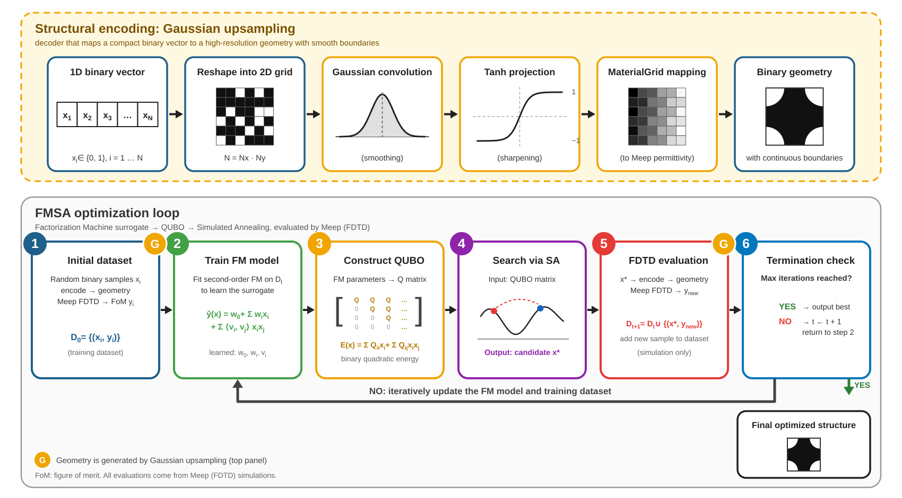
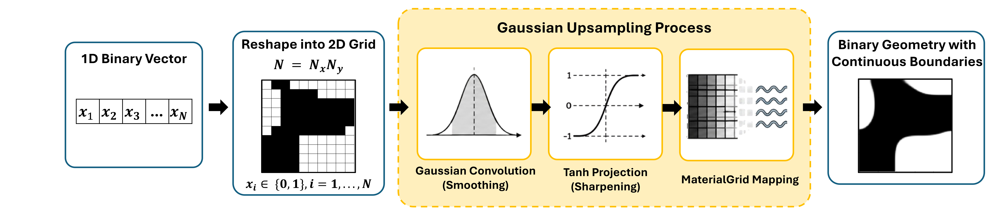
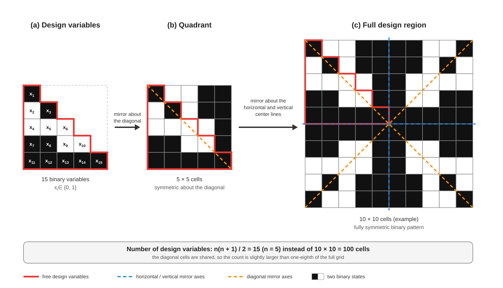
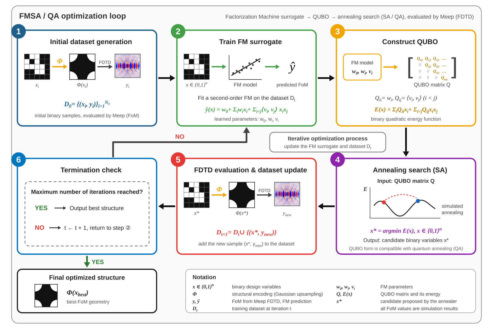

<div align="center"> <h1>Ultra-compact dual-mode Waveguide Crossing <br> via FMSA & Gaussian Upsampling</h1> <p> <strong>利用因子分解機結合模擬退火/量子退火 (Factorization Machine Quantum/Simulated Annealing)演算法<br> 進行交叉型波導結構之反向設計。</strong> </p> <p> <a href="#概述">概述</a> · <a href="#主要貢獻">主要貢獻</a> · <a href="#方法">方法</a> · <a href="#結果">結果</a> · <a href="#教學">教學</a> · <a href="#引用">引用</a> </p> <p>    </p> 



<p> <em> 圖 1. 結構編碼、FMSA/QA 最佳化與電磁模擬評估流程總覽。 </em> </p> </div>

## 概述
<!-- 【放什麼】三段，各 2–3 句： 1. 問題：矽光子逆向設計的設計空間很大 2. 做法：用結構編碼把高解析度結構壓成少量變數，再用 FM 代理模型 + QUBO + SA 搜尋 3. 動機：QUBO 形式可部署到量子退火器 -->

由於光學元件通常具有高維度設計空間，直接以二值像素進行最佳化將增加代理模型建構與搜尋的困難，
因此本研究進一步導入不同的編碼方式作為結構表示方法，來降低設計空間複雜度，同時提升結構表示能力與最佳化效率。

本研究具體採用了高斯上採樣(Gaussian Upsampling)編碼策略。

光學模擬的部分，本研究利用基於有限差分時域法(Finite-Difference Time-Domain, FDTD)的開源套件MEEP，
針對橫電(TE)模態在矽光元件中的傳輸行為進行模擬與分析。

本研究設計並分析了交叉波導(Waveguide Crossing)。
其中，交叉波導則利用結構對稱性降低設計變數維度，在減少設計空間的情況下還能有效抑制模態轉換與串擾(Crosstalk)，並維持高傳輸效率。

編碼後的變數經電磁模擬評估，並以二階因數分解機（Factorization Machine, FM）作為代理模型，
建構二次無約束二元最佳化（QUBO）問題，再交由模擬退火（Simulated Annealing, SA）求解。
由於代理模型以 QUBO 表示，同一套公式也可部署於量子退火器。

可作為未來矽光子反向設計與光子積體電路(Photonic Integrated Circuits, PICs)設計之參考。

注意： 本專案所有結果皆來自 FDTD 模擬（Meep），未進行元件製作或實測。

## 主要貢獻
<!-- 【放什麼】三點即可，每點一句「做了什麼」，不要寫成「用了什麼」。 下面是依你論文內容寫的版本，請對照自己的論文修改。 -->
- FMSA 反向設計架構： 建立可應用於二維矽光子元件的 FMSA 反向設計架構，並以交叉波導為例，完整示範結構編碼、FM 代理模型、QUBO 與 SA 的最佳化流程。
- Gaussian upsampling 結構編碼： 以 Gaussian 卷積、tanh 投影與 MaterialGrid 映射，將少量二元變數轉換為具連續邊界的高解析度結構，作為 FMSA 的結構編碼方式。
- 可重現的 Tutorial： 提供交叉波導的 Jupyter Notebook 教學與 Meep 模擬程式，方便讀者重現與延伸。
    
## 方法
1. 結構編碼
- Gaussian upsampling： 將 1D 二元向量重組成 2D 網格，經 Gaussian 卷積（平滑）、tanh 投影（銳化）與 MaterialGrid 映射，轉換為具連續邊界的二元幾何。
- 八分之一對稱結構： 利用交叉波導的對稱性，只設計八分之一的區域，再以對稱展開得到完整設計區域，大幅減少設計變數。
  
(a) Gaussian upsampling 流程
<!-- 【放什麼】GU_Framework.png 改名為 gu_framework.png，放進 assets/。 可補參數：網格大小 Nx × Ny、Gaussian 的標準差 σ、tanh 的銳化係數 β。 --> <p align="center"> 
 
<br><em>圖 2. Gaussian upsampling：從 1D 二元向量到具連續邊界的二元幾何。</em> </p>
二元向量中的每個變數對應 2D 網格中的一格；Gaussian 卷積使相鄰格子的邊界變得平滑，tanh 投影再把灰階值推回接近 0 或 1，最後經 MaterialGrid 映射成 Meep 可用的材料分佈。如此可用少量二元變數表示高解析度結構，並避免鋸齒狀邊界。

(b) 八分之一對稱結構編碼
<!-- 【放什麼】八分之一結構的圖，檔名 assets/crossing_symmetry.png。 建議圖中標出：被設計的八分之一區域、對稱軸（x、y 軸與對角線）、展開後的完整 2.4 μm × 2.4 μm 結構。 --> <p align="center"> 
 
<br><em>圖 3. 八分之一對稱結構編碼：只設計八分之一區域，再對稱展開為完整交叉波導。</em> </p>

交叉波導的幾何對 x 軸、y 軸與對角線具有鏡像對稱，因此完整的設計區域可由其中八分之一經鏡射展開得到。最佳化時只需決定這八分之一區域的二元變數，設計變數數量約為完整網格的八分之一，FM 代理模型需要學習的參數與 QUBO 的規模也隨之縮小，同時確保得到的結構保持對稱。

<!-- 【放什麼】請對照 Crossing_Tutorial.ipynb，補上： - 八分之一區域的網格大小與設計變數數量 N - 對稱展開發生的順序（展開後再做 Gaussian upsampling，或相反） -->

2. FMSA 最佳化流程
<p align="center">  
<br><em>圖 4. FMSA / QA 最佳化流程：以 FM 代理模型建構 QUBO，經退火搜尋產生候選解，再由 Meep 評估並更新資料集。</em> </p>

每一輪迭代中，FM 代理模型以所有已評估樣本訓練，轉換為 QUBO 後由 SA 求最小值；產生的候選解經解碼成幾何結構，再交給 Meep 評估。

3. 目標元件

| 元件 | 說明 |
|---|---|
| 交叉波導 | Ultra-compact dual-mode waveguide crossing | 
<!-- 再補一句：低損耗、低串擾，兩個模態都要滿足 -->
<details>
<summary><b>模擬設定</b>（點擊展開）</summary>

| 參數 | 數值 | 說明 |
|---|---|---|
| `DPML` | 1.0 | PML 吸收層厚度 |
| `WG_WIDTH` | 1.0 | 輸入／輸出波導寬度 |
| `wl_cen` | 1.55 | 中心波長 |
| `FCEN` | 1 / `wl_cen` | 中心頻率 |
| `DF` | 0.1 × `FCEN` | 頻率寬度 |
| `NFREQ` | 1 | 頻率取樣點數 |
| `resolution` | 40 | 模擬解析度（每單位長度的網格數） |

長度皆為 Meep 單位（1 = 1 μm）。

</details>

<details>
<summary><b>最佳化設定</b>（點擊展開）</summary>

| 類別 | 項目 | 數值 |
|---|---|---|
| 設計空間 | 二元變數（八分之一區域） | (1+12)*12/2 = 78 |
| | 完整網格 | 24 × 24 |
| 資料集 | 初始樣本 | 1000 筆隨機二元變數 |
| | 迭代 | 100 輪，每輪新增 30 筆 |
| | 模擬預算 | 最多 1000 + 100 × 30 = 4000 組設計，每組對 TE₀ 與 TE₁ 各模擬一次 |
| FM 代理模型 | 因數維度 K | 8 |
| | 訓練 | Adam，學習率 1e-3，1000 epochs |
| 退火搜尋 | 取樣器 | SA（`num_reads` = 1500，`num_sweeps` = 1000） |
| 結構編碼 | Gaussian kernel | 5 × 5，σ = 1.0 |
| | tanh 投影 | β = 50，η = 0.5 |

程式預設使用 SA，也可切換為 QA（D-Wave）；QA 失敗時會退回 SA。

</details>

## 結果

所有結果皆來自 Meep 模擬，未進行元件製作或實測。初始隨機樣本以及 SA／QA 的求解過程皆帶有隨機性，因此每次執行不保證得到相同的解，也不保證最終解為全域最佳解。依最佳化理論，本文所稱的「最佳結構」僅指目前找到的最佳解（best-found solution），即所有已評估樣本中 FoM 最低者，而非可證明的最佳解。


#### 收斂過程

FoM = 1 − 平均穿透率，越小越好。

<p align="center">
  
  
  <br><em>圖 5. (a) 最佳 FoM 對迭代次數；(b) 所有評估樣本的 FoM，紅色為初始隨機樣本，藍色為 FMSA 產生的樣本。</em>
</p>

#### 最佳結構

<p align="center">
  
  
  <br><em>圖 6. (a) 最佳的 24 × 24 二元配置；(b) 經 Gaussian upsampling 後 Meep 中的實際結構。</em>
</p>

#### 場分佈

<p align="center">
  
  
  <br><em>圖 7. 最佳結構在中心波長 1.55 μm 的場強度 |E|²：(a) TE₀；(b) TE₁。</em>
</p>

#### 穿透頻譜

<p align="center">
  
  
  <br><em>圖 8. 通過埠穿透率（dB）：(a) TE₀；(b) TE₁。</em>
</p>

頻譜由 1.52、1.56、1.60 μm 三個取樣點平滑內插而成，並非連續掃頻的結果。

| 模態 | 1.52 μm | 1.56 μm | 1.60 μm |
|---|:---:|:---:|:---:|
| TE₀ | -0.296 dB（0.933） | -0.333 dB（0.926） | -0.450 dB（0.901） |
| TE₁ | -0.436 dB（0.904） | -0.458 dB（0.899） | -0.666 dB（0.857） |

Best FoM：0.0960 

#### 計算時間

<p align="center">
  
  <br><em>圖 9. 總執行時間的分佈：FM 訓練、退火取樣、FDTD 模擬與其他。</em>
</p>

## 教學
 
本 repo 依元件分成獨立的 Tutorial，每個 Tutorial 都包含說明文件與可直接執行的模擬程式。
 
### Waveguide Crossing Tutorial（Ultra-compact dual-mode）
 
此 Tutorial 針對 **Ultra-compact dual-mode Waveguide Crossing（兼容超緊湊及雙模態的交叉型波導）** 的設計與實作。
 
#### 內容簡介
 
* **`Crossing_Tutorial.ipynb`**：Jupyter Notebook 教學，說明波導交叉的幾何設計原理，並以圖片（如八分之一對稱結構）輔助解釋如何簡化設計變數與建立結構。
* **`WG_GU_1000_10x10_D2_2mode_40.py`**：隨附的 Python 程式碼，包含建立 $2.4\mu m \times 2.4\mu m$ 尺寸波導交叉所需的參數與函數，用於實際執行設計模擬。
* **`factorization_machine`**：必須與 `Crossing_Tutorial.ipynb` 或 `WG_GU_1000_10x10_D2_2mode_40.py` 放在同一資料夾才可執行。
 
#### 執行

在終端機（Terminal）輸入：

```bash
mpirun -np <核心數> python <py檔名>.py > <自定義log名>.log 2>&1
```

例如，以 31 個核心執行交叉波導的最佳化，並把輸出寫入 `crossing.log`：

```bash
mpirun -np 31 python WG_GU_1000_10x10_D2_2mode_40.py > crossing.log 2>&1
```

**指令說明**

| 片段 | 說明 |
|---|---|
| `mpirun -np <核心數>` | 以 MPI 啟動指定數量的行程（process），`-np` 後面的數字就是行程數 |
| `python <py檔名>.py` | 每個行程都執行同一支 Python 程式 |
| `> <自定義log名>.log` | 把原本印在螢幕上的輸出（迭代進度、FoM 等）寫入自訂的 log 檔 |
| `2>&1` | 把錯誤訊息也導向同一個 log 檔，程式出錯時不會漏掉訊息 |

**平行運作方式**

- 編號 0 的行程是 **master**：產生資料集、訓練 FM、建構 QUBO、執行 SA／QA，並分派模擬工作、整理結果。
- 其餘行程是 **worker**：各自領取一個「設計 + 模態（TE₀ 或 TE₁）」的工作，執行一次 Meep 模擬後回傳 master。
- 因此 `-np 31` 代表 1 個 master 加 30 個 worker，**行程數至少要 2**。每輪新增 30 組設計，每組需模擬 TE₀ 與 TE₁，共 60 個模擬工作，worker 超過 60 個時不會再變快。
- 核心數請依機器的實體核心數設定，不要超過。

**輸出**

結果會寫入執行目錄下的 `Results_Crossing/<工作名稱>_<時間>/`，包含各種圖片與 `final_result.json`。工作名稱可用 `--name` 指定：

`>` 會覆蓋同名的 log 檔；若要保留舊內容並接續寫入，改用 `>>`。
 
### 專案結構
 
```text
.
├── assets/                          # README 使用的圖片
├── factorization machine            # Factorization Machine 模型（需與下列檔案放同一資料夾）
├── Crossing_Tutorial.ipynb          # 交叉波導教學 Notebook
├── WG_GU_1000_10x10_D2_2mode_40.py    # 2.4 × 2.4 μm 交叉波導模擬程式
├── requirements.txt
└── README.md
```

## 引用
 
本專案基於我的碩士論文研究：
 
- **論文題目：** 可部署於量子退火器之矽光子元件反向設計：因數分解機代理模型最佳化
- **英文題目：** Quantum-Annealer-Compatible Inverse Design of Silicon Photonic Devices Using Factorization-Machine Surrogate Optimization
- **作者：** 蔡祐昕（Tsai, Yu-Hsin）
- **學校：** 國立陽明交通大學
- **出版年：** 2026（民國 115 年）
- 論文除交叉波導外，也包含彎曲波導與模態分波解多工器的設計；本 repo 以交叉波導作為教學與重現的範例。
 
若本專案對你的研究有幫助，請引用：
 
<summary>BibTeX</summary>

```bibtex
@mastersthesis{tsai2026quantum,
  title  = {Quantum-Annealer-Compatible Inverse Design of Silicon Photonic
            Devices Using Factorization-Machine Surrogate Optimization},
  author = {Tsai, Yu-Hsin},
  school = {National Yang Ming Chiao Tung University},
  year   = {2026},
  type   = {Master's thesis},
  url    = {https://thesis.lib.nycu.edu.tw/bitstreams/445eff1f-6bb6-4a86-8107-85fb06cd2723/download},
  note   = {Chinese title: 可部署於量子退火器之矽光子元件反向設計：因數分解機代理模型最佳化}
}
```

## 致謝
 
- 感謝指導教授與實驗室成員的指導與討論。
- 感謝 MEEP 提供 FDTD 模擬框架。
